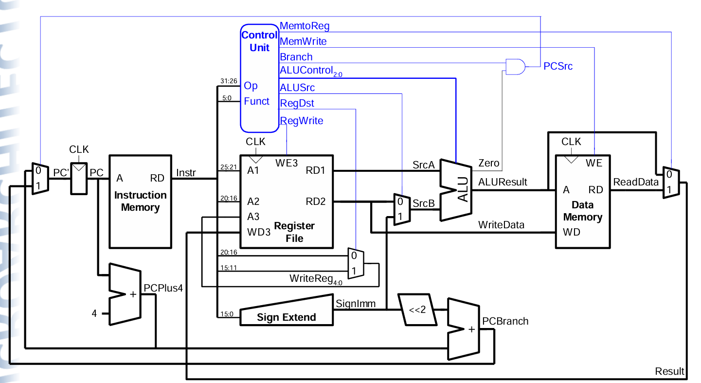
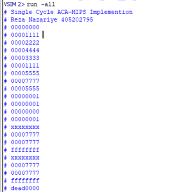
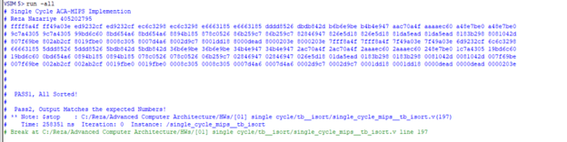

# Single-Cycle MIPS Processor (ACA-MIPS)

## Overview
This project involves the design and implementation of the core datapath and control logic for a 32-bit **Single-Cycle MIPS** processor. The processor supports a subset of the ACA-MIPS instruction set architecture (ISA), including arithmetic, logical, memory access, and branch instructions.

*Note: The memory modules, Register File, ALU, and basic testbenches were provided as part of the course scaffolding. The author's primary contribution was the structural design of the top-level datapath, the implementation of the fully combinational Control Unit, and extending the architecture to support additional ISA instructions.*

**Course:** Advanced Computer Architecture  
**Institution:** Sharif University of Technology  
**Instructor:** Dr. Movahedin

## Architecture & Supported Instructions
The processor features a standard MIPS datapath consisting of an ALU, Register File, Control Unit, Instruction/Data Memories, and a Program Counter.

*Figure 1: Single-Cycle MIPS Datapath Architecture.*

**Supported Instructions:**
| Format | Instructions |
| :--- | :--- |
| **R-Type** | `add`, `sub`, `addu`, `subu`, `and`, `or`, `xor`, `nor`, `slt`, `sltu` |
| **I-Type** | `addi`, `addiu`, `slti`, `sltiu`, `andi`, `ori`, `xori`, `lui`, `beq`, `bne`, `lw`, `sw` |
| **J-Type** | `j` (Jump) |

## Key Architectural Modifications
While the baseline architecture was derived from standard textbook designs, significant datapath and control modifications were made to support the full instruction set:

1.  **Immediate Extension Logic:** Added multiplexing logic to choose between **Sign-Extension** (for `addi`, `lw`, `sw`, etc.) and **Zero-Extension** (required for logical operations like `andi`, `ori`, `xori`, `sltiu`).
2.  **LUI Support:** Implemented a custom datapath route to shift the 16-bit immediate value into the upper half of the 32-bit register for the `lui` (Load Upper Immediate) instruction.
3.  **BNE Control Logic:** Extended the control unit to differentiate between `beq` and `bne`, adding an inverted branch condition path (`Bne_src`) to the PC multiplexer.
4.  **Jump Instruction:** Added support for J-format jump instructions by concatenating the PC+4 upper bits with the 26-bit jump target.

## Verification & Testing
The processor was rigorously verified using two distinct ModelSim testbenches.

### 1. Basic Test (`tb_basic.v`)
Tests individual instructions and datapath routing. 
*   **Author's Contribution:** The provided `basic.hex` test did not cover the `lui` instruction. I modified the assembly code and the testbench parameters to inject the `lui` instruction and verify the upper-immediate load operation successfully.

### 2. Insertion Sort Test (`tb_isort.v`)
A comprehensive program that generates an array of 32-bit numbers, sorts them using an insertion sort algorithm, and stores them back in memory. 
*   **Verification Mechanism:** The testbench checks two conditions: (1) if the array is actually sorted (`err_unsorted`), and (2) if the sorted numbers match the golden reference `exp_sorted_numbers.hex` (`err_exp`).

## Results
*   **Basic Test:** The simulation log confirms correct execution of all instructions, including the custom `lui` addition (`0xdead0000` successfully stored in memory).
*   **isort Test:** The processor successfully executed the sorting algorithm. The simulation log printed `PASS1, All Sorted!` and `Pass2, Output Matches the expected Numbers!`.

*Figure 2: Simulation output confirming basic instruction execution, including the modified LUI test.*

*Figure 3: ModelSim console showing successful insertion sort execution.*

## Documentation
For a detailed breakdown of the design decisions, datapath modifications, and testbench modifications, please refer to the full project report (in Persian فارسی):
[Project Report (PDF)](docs/report.pdf)
